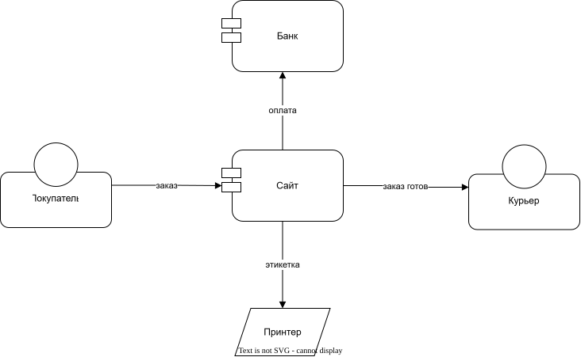

# archtale

Архитектура, рассказанная историей. Модель живёт блоками прямо в
md-документации, из неё генерируются диаграммы draw.io, а ручная раскладка
переживает перегенерацию.

## Зачем

archtale решает три проблемы документации архитектуры:

- **Формальное описание.** Модель задаётся стрелками и типами, а не прозой,
  поэтому она однозначна и для человека, и для инструментов. В прозе остаётся
  то, что формально не выразить: зачем и почему так.
- **Актуальность схем.** Схемы генерируются из модели и не расходятся с ней.
  Ручная раскладка при этом сохраняется.
- **Всё в одном месте.** Модель описывается прямо в тексте документации,
  специальные файлы для неё не нужны.

## Пример

````md
Покупатель оформляет заказ на сайте.

```model order-flow
customer "Покупатель" [person] -> site "Сайт" [application]: заказ
```

Сайт списывает оплату через банк.

```model order-flow
site -> bank "Банк" [application]: оплата
```

<!-- archtale:diagram order-flow -->
````

Блоки в прозе собираются в одну схему. Полный пример из папки `demo-shop`:



**Статус:** ранняя версия, формат ещё может меняться.

## Установка

Нужны Node.js и [draw.io desktop](https://github.com/jgraph/drawio-desktop/releases).

```
git clone <url>
cd archtale
npm install
npm run build
npm link
```

После правок кода снова выполните `npm run build`. Удалить команду:
`npm unlink -g archtale`.

## Использование

Запускайте из корня документации:

```
archtale generate    # создать и обновить схемы
archtale check       # показать расхождения в модели
```

Вместо текущей папки можно указать другую: `archtale check docs`.

| Опция | Команда | Назначение |
|---|---|---|
| `--strict` | `check` | ненулевой код выхода, если есть замечания |
| `--strict` | `generate` | ненулевой код выхода, если остались схемы без рендера |
| `--drawio <path>` | `generate` | путь к draw.io, если он не найден автоматически |

Без draw.io XML схем обновляется, но картинка остаётся старой, а в отчёте
будет написано, сколько схем ждут рендера.

## Блок модели

````md
```model [id-схемы]
откуда -> куда: подпись
```
````

| Запись | Смысл |
|---|---|
| `a -> b` | связь, подпись необязательна |
| `a -flows-> b` | связь с типом |
| `[id] a -> b` | явный id, когда одинаковых связей несколько |
| `a "Имя" [тип]` | имя и тип, при любом упоминании |
| `# текст` | комментарий |

Id элементов и схем, а также типы пишутся в kebab-case. Элемент существует,
как только упомянут, и един на всю документацию. Имя и тип достаточно указать
один раз в любом файле.

Блок без связей содержит только объявления: `bank "Банк" [application]`.
Он задаёт имя и тип, но схемы не создаёт и на другие схемы элемент не выводит.
Так можно вести справочник элементов. В блоке со связями такая строка ставит
элемент на схему этого блока.

## Схемы

| Заголовок | Какие блоки собираются | Файл схемы |
|---|---|---|
| ` ```model ` | блоки без id из этого файла | `diagrams/<файл>.drawio.svg` рядом с md |
| ` ```model my-id ` | блоки с этим id из любых файлов | `<корень>/diagrams/my-id.drawio.svg` |

Подключить схему можно до генерации, тегом. Без id он означает схему этого файла:

```md
<!-- archtale:diagram -->
<!-- archtale:diagram my-id -->
```

Генератор поддерживает картинку в строке сразу под тегом. Если там уже стоит
другая картинка, она будет заменена. Обычная ссылка `` тоже работает.

## Ручная правка

Открывайте `.drawio.svg` в draw.io, двигайте элементы и стрелки, добавляйте
свои фигуры. При перегенерации:

- положение и размер элементов сохраняются, подписи берутся из модели;
- новый элемент встаёт рядом с соседом, в отчёте он отмечен как
  `требует раскладки`;
- удалённый из модели элемент исчезает вместе со связями;
- ваши фигуры и копии не трогаются;
- фигура, которой вы сами задали id модели через Edit Data, остаётся как есть,
  обновляется только подпись.

Содержимое элемента принадлежит файлу типа. Правки внутри него на схеме
теряются при генерации, поэтому особый элемент делайте отдельным типом.

## Типы

Тип — свободная метка, реестра нет. Для каждого типа создаётся файл
`<корень>/archtale-types/<тип>.drawio.svg`, а для элементов без типа —
`default.drawio.svg`. Всё, что в нём нарисовано, и есть фигура типа, в том числе
составная. В тексте подставляются свойства:

| Свойство | Значение |
|---|---|
| `%caption%` | имя элемента |
| `%id%` | id элемента |
| `%type%` | тип элемента |

Готовые файлы типов генератор не перезаписывает, а неиспользуемые не удаляет,
только сообщает о них. Правка файла доходит до всех схем при следующей генерации.

## Чекер

`archtale check` ничего не запрещает и показывает со ссылками `файл:строка`:

- ошибки синтаксиса;
- разные имена или типы у одного id;
- одну связь с разными подписями на одной схеме (на разных схемах подписи могут отличаться);
- похожие id и типы, вероятные опечатки;
- элементы без имени или типа;
- элементы, упомянутые один раз;
- теги на несуществующие схемы.

## Ограничения

- Запускайте из корня документации: запуск из подпапки создаст там вторые
  `diagrams/` и `archtale-types/`.
- Новые элементы раскладываются просто и могут наложиться на соседние.
- Стрелки идут к границе контейнера элемента, а не к самой фигуре.
- У связей один стиль на все, типы связей на вид пока не влияют.
- Фон схем прозрачный: на тёмной теме чёрные стрелки и подписи плохо видны.

## Разработка

```
npm test              # тесты
npm run build         # сборка в dist/
npm run demo          # генерация по папке demo-shop/
```
