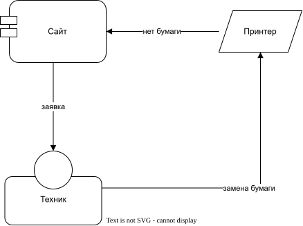

# Обслуживание принтера

Магазин не держит своего специалиста: он нанимает техника, который следит за
оборудованием.

```model service-contract
shop "Магазин" [company] -> technician "Техник" [person]: нанимает
technician -> printer: обслуживает
```

<!-- archtale:diagram service-contract -->


Когда заканчивается бумага, принтер сообщает об этом сайту. Сайт создаёт заявку
на обслуживание, и техник заправляет принтер.

```model
printer -> site: нет бумаги
site -> technician: заявка
technician -> printer: замена бумаги
```

<!-- archtale:diagram -->

