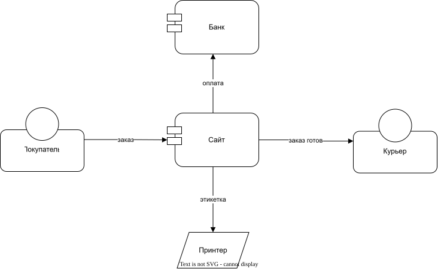

# Интернет-магазин

<!-- archtale:diagram order-flow -->


Покупатель оформляет заказ на сайте.

```model order-flow
customer -> site: заказ
```

Сайт списывает оплату через банк.

```model order-flow
site -> bank: оплата
```

Оплаченный заказ сайт отправляет на печать этикетки.

```model order-flow
site -> printer: этикетка
```
