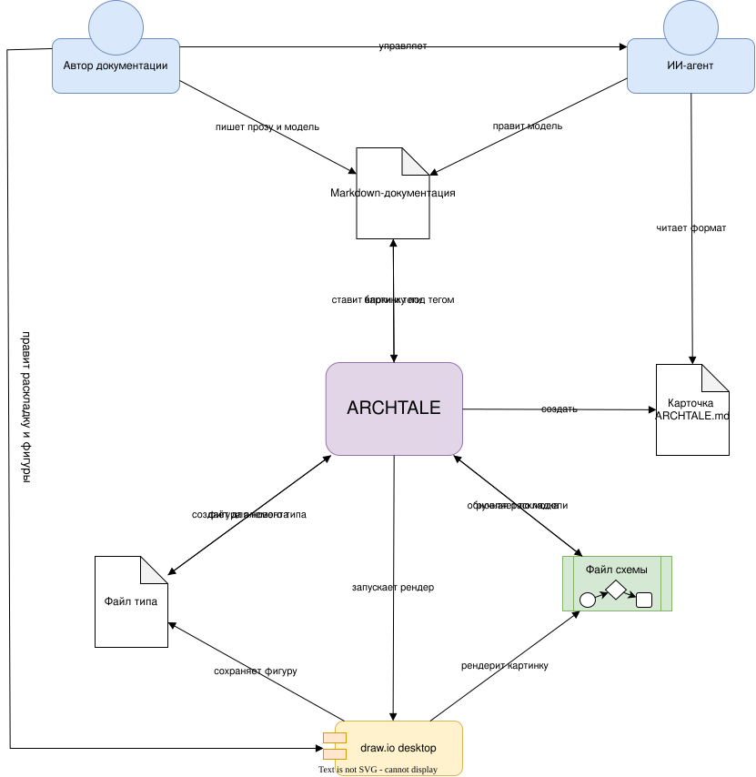

# Как это работает

<!-- archtale:diagram -->


## 1. Автор описывает модель

Автор при помощи ИИ описывает модель, или пишет напрямую `model`.

```model
author -> markdown: пишет прозу и модель
author -> ai-agent: управляет
```

## 2. ИИ-агент узнаёт формат

Агенту не нужно знать archtale заранее: формат он узнаёт из карточки и затем
правит модель в тех же блоках, что и автор.

```model
ai-agent -> card: читает формат
ai-agent -> markdown: правит модель
```

## 3. archtale читает документацию

Команда `archtale generate` собирает блоки и теги из всех md-файлов. Если в модели
есть ошибка синтаксиса, генерация останавливается до записи файлов. `archtale check`
тоже читает документацию, но только показывает замечания и ничего не меняет.

```model
markdown -> archtale: блоки и теги
```

## 4. archtale готовит карточку и типы

При первой генерации archtale создаёт карточку. Для каждого нового типа он создаёт
файл типа и берёт из него фигуру элемента. Готовые файлы не перезаписываются.

```model
archtale -> card: создать
archtale -> type-svg: создаёт для нового типа
type-svg -> archtale: фигура элемента
```

## 5. archtale обновляет схемы

Из существующего файла схемы archtale берёт ручную раскладку, а элементы, связи и
подписи — из модели. Результат записывается обратно в тот же файл.

```model
diagram-svg -> archtale: ручная раскладка
archtale -> diagram-svg: обновляет по модели
```

## 6. draw.io рендерит картинку

archtale запускает draw.io, и тот обновляет картинку в файле схемы. Без draw.io XML
схемы уже новый, но картинка остаётся старой, а в отчёте будет указано, сколько
схем ждут рендера.

```model
archtale -> drawio: запускает рендер
drawio -> diagram-svg: рендерит картинку
```

## 7. Схема появляется в документации

Под каждым тегом схемы archtale ставит ссылку на картинку.

```model
archtale -> markdown: ставит картинку под тегом
```

## 8. Автор правит раскладку

Автор открывает файл схемы в draw.io и двигает элементы, а в файле типа меняет
фигуру. Раскладка переживёт следующую генерацию, а новая фигура дойдёт до всех схем.

```model
author -> drawio: правит раскладку и фигуры
drawio -> type-svg: сохраняет фигуру
```
