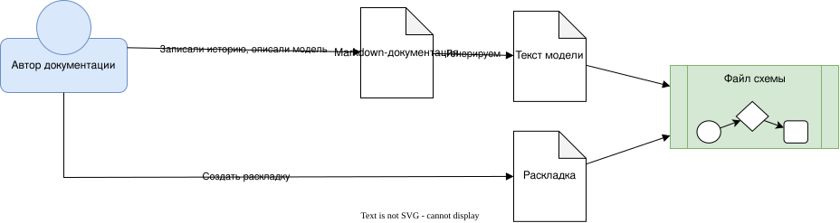

# Как создать диаграмму

<!-- archtale:diagram -->


В прозе автор может выражаться неточно или называть одно и то же разными словами. Но суть почти всегда умещается в одну строку: субъект, объект и действие.

На этом минималистичном языке можно рассказать, что здесь происходит.

```model
author -> markdown : Записали историю, описали модель
```

Такая строка похожа на выжимку из абзаца или раздела. Важной её делает то, что субъект и объект — это якоря модели.

Якорь — то, за что может зацепиться мозг. Изучая схему, человек сначала смотрит на её компоненты и только потом видит связи между ними. Компоненты и есть наши якоря. Поэтому на всех схемах они должны быть одними и теми же: с одинаковыми названиями и одинаковым внешним видом. Тогда читатель будет узнавать героев и понимать, что перед ним одна и та же история.

Значит, история в md должна стыковаться с диаграммой, и что-то из них должно появляться первым: схема или описание. Раньше можно было начинать со схемы. Но благодаря LLM на первое место выходит текст, а схема остаётся для человека: глаза любят картинки.

```model
markdown -> model-svg "Текст модели" [file] : Генерируем
```

Так мы получаем схему, основанную на описании модели. Она показывает компоненты и связи, в контексте которых мы сейчас находимся. Но схема — это не только компоненты и связи, но и форма, цвет и композиция: именно они расставляют правильные акценты. Поэтому схема, которая полагается только на рендер, всегда будет уступать схеме, созданной автором.

Такой схеме нужно вмешательство автора.

```model
author -> layout-svg "Раскладка" [file]: Создать раскладку
```

Эта последовательность гарантирует актуальное наполнение схемы, а это самое главное: вторичные схемы всегда отстают от модели. LLM плохо понимают формат SVG: чтобы извлечь суть, им нужно правильно распознать все векторы и связи, а редактирование схем идёт долго и неэффективно. Поэтому оставим схемы для человеческого глаза: гораздо проще передвинуть элементы в редакторе, чем объяснять это LLM.

В нашем случае diagram-svg состоит из двух частей: модели и раскладки. Модель описывает элементы и связи между ними, а раскладка — их расположение и внешний вид.

```model
model-svg -> diagram-svg
layout-svg -> diagram-svg
```

Благодаря этому модель (а это главное) всегда остаётся актуальной, а раскладку можно обновлять по мере необходимости.
